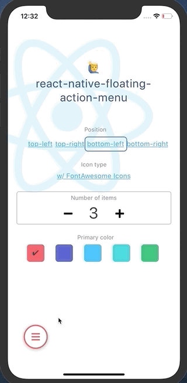
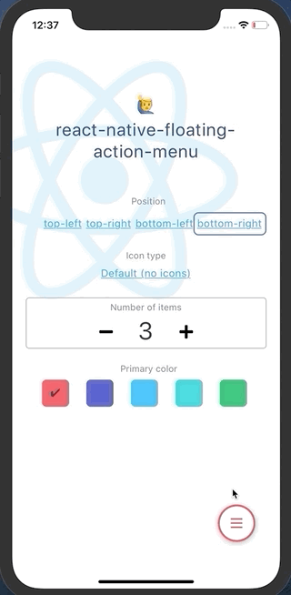
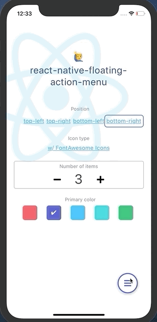

<div align="center">
  <h1>react-native-floating-action-menu</h1>

  <div>B-Y-O-I (bring your own icon) component for React Native. No dependencies. Inspired by Material Design's Floating Action Button. Please customize to your needs and enjoy. PRs are welcome!</div>

  <br/>

  
</div>

## Installation

```sh
npm install react-native-floating-action-menu
# or
pnpm add react-native-floating-action-menu
```

## Usage

```jsx
import { FloatingMenu } from "react-native-floating-action-menu";

const items = [
  { label: "Do a little dance" },
  { label: "Make a lil love" },
  { label: "Get down tonight" },
];

<FloatingMenu
  items={items}
  isOpen={isMenuOpen}
  onMenuToggle={setIsMenuOpen}
  onItemPress={(item, index) => console.log("pressed", item)}
/>;
```

## Item Config

| Prop               | Description                                                                           | Type                     | Required |
| ------------------ | ------------------------------------------------------------------------------------- | ------------------------ | -------- |
| label              | Text to display alongside the button                                                  | `React.ReactNode`        | ✔︎        |
| accessibilityLabel | Accessible label for screen readers. Defaults to `label` if it is a string.           | `string`                 |          |
| labelStyle         | Style for the label Text element                                                      | `StyleProp<TextStyle>`   |          |
| isPending          | Displays an ActivityIndicator in place of the icon                                    | `boolean`                |          |
| isDisabled         | Disables the item                                                                     | `boolean`                |          |
| onPress            | Callback when this item is pressed. Overrides the `onItemPress` prop on FloatingMenu. | `(event, index) => void` |          |
| buttonStyle        | Style for the TouchableWithoutFeedback wrapper                                        | `StyleProp<ViewStyle>`   |          |
| buttonInnerStyle   | Style for the inner animated view                                                     | `StyleProp<ViewStyle>`   |          |
| containerStyle     | Style for the outer animated container                                                | `StyleProp<ViewStyle>`   |          |

Any additional `ViewProps` are spread onto the outer container.

## Menu Config

| Prop                  | Description                                                                                                                                     | Type                                                           | Default             |
| --------------------- | ----------------------------------------------------------------------------------------------------------------------------------------------- | -------------------------------------------------------------- | ------------------- |
| items                 | Array of item configs (see above). Items are ordered starting closest to the menu button.                                                       | `ItemConfig[]`                                                 | `[]`                |
| isOpen                | Controls the open/closed state                                                                                                                  | `boolean`                                                      | —                   |
| position              | Corner to anchor the menu                                                                                                                       | `"top-left" \| "top-right" \| "bottom-left" \| "bottom-right"` | `"bottom-right"`    |
| top                   | Distance from the top edge (px)                                                                                                                 | `number`                                                       | `38`                |
| left                  | Distance from the left edge (px)                                                                                                                | `number`                                                       | `38`                |
| right                 | Distance from the right edge (px)                                                                                                               | `number`                                                       | `38`                |
| bottom                | Distance from the bottom edge (px)                                                                                                              | `number`                                                       | `38`                |
| primaryColor          | Base color for borders, backgrounds, and icons                                                                                                  | `string`                                                       | `"#213A77"`         |
| backgroundUpColor     | Button background in the unpressed state                                                                                                        | `string`                                                       | `"#ffffff"`         |
| backgroundDownColor   | Button background in the pressed state                                                                                                          | `string`                                                       | `primaryColor`      |
| borderColor           | Override border color                                                                                                                           | `string`                                                       | `primaryColor`      |
| iconColor             | Override icon color                                                                                                                             | `string`                                                       | `primaryColor`      |
| buttonWidth           | Width and height of each button                                                                                                                 | `number`                                                       | auto (responsive)   |
| innerWidth            | Width and height of the inner button element                                                                                                    | `number`                                                       | `buttonWidth * 0.8` |
| containerStyle        | Style for the outermost full-screen container                                                                                                   | `StyleProp<ViewStyle>`                                         | —                   |
| itemContainerStyle    | Style for the column of buttons                                                                                                                 | `StyleProp<ViewStyle>`                                         | —                   |
| buttonOuterStyle      | Style for the menu button's outer view                                                                                                          | `StyleProp<ViewStyle>`                                         | —                   |
| buttonTouchableStyle  | Style for the menu button's touchable                                                                                                           | `StyleProp<ViewStyle>`                                         | —                   |
| buttonInnerStyle      | Style for the menu button's inner animated view                                                                                                 | `StyleProp<ViewStyle>`                                         | —                   |
| dimmerStyle           | Style for the background dimmer overlay                                                                                                         | `StyleProp<ViewStyle>`                                         | —                   |
| openEase              | Easing function for the open animation                                                                                                          | `(t: number) => number`                                        | cubic ease-out      |
| closeEase             | Easing function for the close animation                                                                                                         | `(t: number) => number`                                        | cubic ease-in       |
| menuOpenLabel         | Accessibility label when the menu is closed                                                                                                     | `string`                                                       | `"Open menu"`       |
| menuCloseLabel        | Accessibility label when the menu is open                                                                                                       | `string`                                                       | `"Close menu"`      |
| renderMenuIcon        | Render prop for the menu button icon. Receives current render state.                                                                            | `(state: RenderState) => React.ReactNode`                      | —                   |
| renderItemIcon        | Render prop for item icons. Receives item, index, and render state.                                                                             | `(item, index, state: RenderState) => React.ReactNode`         | —                   |
| renderButtonContainer | Render prop that replaces the default button container `View`. Use this to position the menu with Reanimated or any external animation library. | `(children, style) => React.ReactElement`                      | —                   |
| onMenuToggle          | Called when the menu button is pressed. Receives the new open state.                                                                            | `(open: boolean) => void`                                      | —                   |
| onPress               | Called when the button is pressed and `items` is empty — use this to make the FAB a standalone button.                                          | `(event: GestureResponderEvent) => void`                       | —                   |
| onItemPress           | Called when an item is pressed. Receives the item and its index. Ignored if the item defines its own `onPress`.                                 | `(item: ItemConfig, index: number) => void`                    | —                   |

## Gif Demos

<table>
<thead />
<tbody>
<tr>
  <td width="25%">
    <p><b>Positions</b></p>
    
  </td>
  <td width="25%">
    <p><b>FontAwesome</b></p>
    
  </td>
  <td width="25%">
    <p><b>Colors</b></p>
    
  </td>
  <td width="25%">
    <p><b>List lengths</b></p>
    
  </td>
</tr>
</tbody>
</table>

## Quick Start Example

```jsx
import React, { useState } from "react";
import { StyleSheet, View } from "react-native";
import { FloatingMenu } from "react-native-floating-action-menu";

const items = [
  { label: "Do a little dance" },
  { label: "Make a little love" },
  { label: "Get down tonight" },
];

export default function MyScreen() {
  const [isMenuOpen, setIsMenuOpen] = useState(false);

  return (
    <View style={styles.container}>
      <FloatingMenu
        isOpen={isMenuOpen}
        items={items}
        onMenuToggle={setIsMenuOpen}
        onItemPress={(item, index) => console.log("pressed item", item)}
      />
    </View>
  );
}

const styles = StyleSheet.create({
  container: {
    flex: 1,
  },
});
```

## Example with Custom Icons (FontAwesome, Images)

```jsx
import { faBars, faTimes, faUserPlus } from "@fortawesome/free-solid-svg-icons";
import { FontAwesomeIcon } from "@fortawesome/react-native-fontawesome";
import React, { useState } from "react";
import { Image, View } from "react-native";
import { FloatingMenu } from "react-native-floating-action-menu";

const primaryColor = "#09f";

const items = [
  { label: "Add user", fa: faUserPlus },
  { label: "Gallery", image: require("../assets/img-0.png") },
];

export default function MyScreen() {
  const [isMenuOpen, setIsMenuOpen] = useState(false);

  const renderMenuIcon = ({ menuButtonDown }) => (
    <FontAwesomeIcon
      icon={isMenuOpen ? faTimes : faBars}
      size={22}
      color={menuButtonDown ? "#fff" : primaryColor}
    />
  );

  const renderItemIcon = (item, index, { itemsDown }) => {
    const color = itemsDown[index] ? "#fff" : primaryColor;

    if (item.fa) {
      return <FontAwesomeIcon icon={item.fa} size={22} color={color} />;
    }
    if (item.image) {
      return (
        <Image
          source={item.image}
          style={{ tintColor: color }}
          resizeMode="contain"
        />
      );
    }
    return null;
  };

  return (
    <View style={{ flex: 1 }}>
      <FloatingMenu
        isOpen={isMenuOpen}
        items={items}
        primaryColor={primaryColor}
        onMenuToggle={setIsMenuOpen}
        onItemPress={(item, index) => console.log("pressed", item.label)}
        renderMenuIcon={renderMenuIcon}
        renderItemIcon={renderItemIcon}
      />
    </View>
  );
}
```

## Example with Reanimated (dynamic position)

Use `renderButtonContainer` to drive the menu position with Reanimated or any external animation library, without adding it as a dependency.

```jsx
import { FloatingMenu } from "react-native-floating-action-menu";
import Animated, {
  useAnimatedStyle,
  useSharedValue,
  withSpring,
} from "react-native-reanimated";

export default function MyScreen() {
  const [isMenuOpen, setIsMenuOpen] = useState(false);
  const offsetY = useSharedValue(0);

  const animatedStyle = useAnimatedStyle(() => ({
    transform: [{ translateY: withSpring(offsetY.value) }],
  }));

  return (
    <View style={{ flex: 1 }}>
      <FloatingMenu
        isOpen={isMenuOpen}
        items={items}
        onMenuToggle={setIsMenuOpen}
        renderButtonContainer={(children, style) => (
          <Animated.View
            style={[style, animatedStyle]}
            pointerEvents="box-none">
            {children}
          </Animated.View>
        )}
      />
    </View>
  );
}
```

## Run Example

```sh
git clone https://github.com/nicotroia/react-native-floating-action-menu
cd react-native-floating-action-menu/example
pnpm install
pnpm start
```

## License

MIT © 2019-2026 [internet-nico](https://nicotroia.com)
